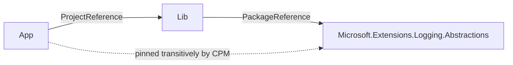

# `dotnet package update` fails with NU1109 when CPM transitive pinning is enabled

`dotnet package update` cannot update a package in a solution that uses Central Package Management with `CentralPackageTransitivePinningEnabled=true` when some project gets that package only transitively, through a project reference. The preview restore reports a false `NU1109 Detected package downgrade` and the command exits with code 3 without changing any file. Editing the version in `Directory.Packages.props` by hand restores without errors, so the conflict exists only in the command's in-memory preview.

In real solutions this blocks almost every update. A solution with layered projects (app -> api -> core) and transitive pinning hits it for every package referenced in a lower layer: our 45-project solution produced 649 NU1109 errors and no update at all.

## Environment

| Item     | Value                    |
| -------- | ------------------------ |
| Product  | dotnet.exe (dotnet CLI)  |
| SDK      | 10.0.300                 |
| OS       | macOS 26.6.2, arm64      |
| Worked before? | No - the command was introduced in .NET 10 |

## Repro

The repository contains two projects and one central package version:



`Directory.Packages.props`:

```xml
<Project>
  <PropertyGroup>
    <ManagePackageVersionsCentrally>true</ManagePackageVersionsCentrally>
    <CentralPackageTransitivePinningEnabled>true</CentralPackageTransitivePinningEnabled>
  </PropertyGroup>
  <ItemGroup>
    <PackageVersion Include="Microsoft.Extensions.Logging.Abstractions" Version="10.0.0" />
  </ItemGroup>
</Project>
```

`src/Lib/Lib.csproj` references the package, `src/App/App.csproj` references only `Lib`:

```xml
<!-- src/Lib/Lib.csproj -->
<ItemGroup>
  <PackageReference Include="Microsoft.Extensions.Logging.Abstractions" />
</ItemGroup>

<!-- src/App/App.csproj -->
<ItemGroup>
  <ProjectReference Include="../Lib/Lib.csproj" />
</ItemGroup>
```

Steps:

```shell
dotnet restore PackageUpdateCpm.slnx
dotnet package update --project PackageUpdateCpm.slnx
```

### Expected

`Directory.Packages.props` is updated to the latest version (10.0.13 at the time of writing), the same result as editing the file by hand and running `dotnet restore`, which succeeds.

### Actual

```text
Updating outdated packages in /Users/jand/dev/jdvor/package-update-cpm/PackageUpdateCpm.slnx.
error: NU1109: Detected package downgrade: Microsoft.Extensions.Logging.Abstractions from 10.0.13 to centrally defined 10.0.0. Update the centrally managed package version to a higher version.
error:  App -> Lib -> Microsoft.Extensions.Logging.Abstractions (>= 10.0.13)
error:  App -> Microsoft.Extensions.Logging.Abstractions (>= 10.0.0)
Preview restore with updated packages was not successful. Force mode is not yet available.
```

Exit code 3, no file changed.

### Variations

| `CentralPackageTransitivePinningEnabled` | App references the package directly | Result |
| ---------------------------------------- | ----------------------------------- | ------ |
| `true`                                   | no                                  | fails with NU1109 |
| `true`                                   | yes                                 | succeeds |
| `false`                                  | no                                  | succeeds |

### Why turning off transitive pinning is not a fix

The repro could pass by setting `CentralPackageTransitivePinningEnabled=false`, but the real solution needs pinning, so that is not a workaround.

Pinning is how a CPM solution forces a safe version of a package it gets only transitively, typically after a NuGetAudit warning (NU1901-NU1904) for a dependency of a dependency. Since .NET 10, `dotnet restore` [audits transitive packages by default](https://learn.microsoft.com/dotnet/core/compatibility/sdk/10.0/nugetaudit-transitive-packages), so these warnings are now routine. One `PackageVersion` entry in `Directory.Packages.props` raises the version for every project that pulls the package in, without touching any project file. Our solution has 14 such entries that no project references directly.

Without pinning, a `PackageVersion` entry for a package that is not referenced directly has no effect. The only alternative is to add a direct `PackageReference` to every project that pulls the vulnerable package in. That spreads one security fix over many project files, and the references stay long after the parent package ships a fixed version. NuGet's own guide for [fixing vulnerable transitive packages](https://learn.microsoft.com/nuget/concepts/auditing-packages#actions-when-packages-with-known-vulnerabilities-are-reported) lists CPM transitive pinning as one of the remedies, and the same page recommends `dotnet package update --vulnerable`. Both should work together.

## Probable cause

References are to [NuGet.Client at `91c2a16`](https://github.com/NuGet/NuGet.Client/tree/91c2a1660a0a554a7e05ab07848105019a81e1a7).

1. The command decides what to update per project, from that project's direct dependencies only ([`GetAllPackagesReferencedByProject`](https://github.com/NuGet/NuGet.Client/blob/91c2a1660a0a554a7e05ab07848105019a81e1a7/src/NuGet.Core/NuGet.CommandLine.XPlat/Commands/Package/Update/PackageUpdateCommandRunner.cs#L788)). `App` has no direct reference to the package, so it gets no update.
2. [`GetUpdatedDependencyGraphSpec`](https://github.com/NuGet/NuGet.Client/blob/91c2a1660a0a554a7e05ab07848105019a81e1a7/src/NuGet.Core/NuGet.CommandLine.XPlat/Commands/Package/Update/PackageUpdateCommandRunner.cs#L842) builds the preview graph by cloning only the projects that have updates. `App` keeps its original spec, including its copy of the central package versions, which still says 10.0.0.
3. Even for the cloned projects, the two-argument [`PackageSpecOperations.AddOrUpdateDependency`](https://github.com/NuGet/NuGet.Client/blob/91c2a1660a0a554a7e05ab07848105019a81e1a7/src/NuGet.Core/NuGet.ProjectModel/PackageSpecOperations.cs#L30) changes only the dependency's version range and leaves `CentralPackageVersions` untouched. The CPM-aware path in the same class (`GetTargetFrameworkInformationWithAddedDependency`) does update it.
4. During the preview restore, `Lib` requires `>= 10.0.13`, while transitive pinning makes `App` pin the package to its stale central version 10.0.0, which NuGet reports as NU1109.

With CPM, a new version in `Directory.Packages.props` applies to every project that imports the file. The preview graph should therefore update the central package versions of all projects sharing that file, not only the dependencies of projects that reference the package directly.

## Workaround

Edit the versions in `Directory.Packages.props` directly, for example from the output of `dotnet package list --outdated --format json`, then run `dotnet restore`.

## Related

- [NuGet/Home#13793](https://github.com/NuGet/Home/issues/13793) - the same false NU1109 with CPM and transitive pinning when updating several packages in the Visual Studio package manager UI.
